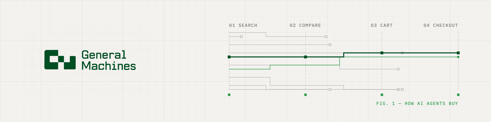

<a href="https://generalmachines.ai/?utm_source=github&utm_medium=org_readme">
  <picture>
    <source media="(prefers-color-scheme: dark)" srcset="./assets/gm-banner-dark-v3.png">
    
  </picture>
</a>

# General Machines

General Machines is an applied AI research lab building open datasets, evals and small models for the agentic web and physical AI.

Our first focus is commerce. [Machine Commerce](https://machinecommerce.co/?utm_source=github&utm_medium=org_readme), the agentic commerce arm of General Machines, studies how AI agents search, compare and pay in online stores, and which store details decide whether they can buy.

## Releases

| Release | Type | Status | Links |
|---|---|---|---|
| **CartTrace-100k** | Dataset | Coming soon | |
| **CartBench** | Benchmark | Planned | |
| **Commerce&#8209;1** | Small evaluator model | Planned | |

## Contact

Working on shopping agents, agent evaluations or an online store? Write to [founders@generalmachines.ai](mailto:founders@generalmachines.ai).

  <a href="https://generalmachines.ai/?utm_source=github&utm_medium=org_readme">generalmachines.ai</a> ·
  <a href="https://machinecommerce.co/?utm_source=github&utm_medium=org_readme">machinecommerce.co</a> ·
  <a href="https://huggingface.co/generalmachines">Hugging Face</a> ·
  <a href="https://x.com/machinecommerce">X</a> ·
  <a href="https://www.linkedin.com/company/generalmachinesai">LinkedIn</a> ·
  <a href="https://generalmachines.ai/careers/?utm_source=github&utm_medium=org_readme">Careers</a>

General Machines Pte. Ltd., Singapore.
